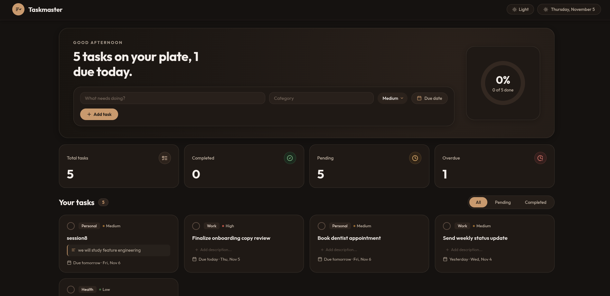

# ✦ TASKMASTER

A warm, editorial task management application designed to help you plan your day, one line at a time.

Built with **Next.js 16**, **React 19**, **TypeScript**, and **Supabase** (PostgreSQL).



---

## Features

- **Dynamic greeting & date pill** — greeting updates based on time of day (morning / afternoon / evening) alongside a live calendar pill.
- **Progress donut chart** — circular SVG completion ring showing completion percentage and ratio.
- **Quick entry with metadata** — create tasks with a title, category tag, due date picker, and priority selector (Low / Medium / High).
- **Interactive descriptions** — click any task or the description icon to open an expandable drawer to view, add, or update task notes.
- **Live tally cards** — real-time status counters for Total Tasks, Completed, Pending, and Overdue items.
- **Filter tabs** — seamlessly switch views between All, Pending, and Completed tasks with a real-time counter.
- **Status toggle & instant delete** — check off completed tasks with custom checkboxes or remove them with a single click.
- **Dark mode** — switch between a warm editorial cream light theme and a rich coffee-toned dark theme (remembers preference in `localStorage`, respects system theme).
- **Artisanal coffee loader** — custom animated SVG coffee mug brewing/steaming during initial data load.
- **Responsive design** — crafted layout adapting cleanly from wide desktop screens to tablets and mobile devices.

---

## Tech Stack

| Layer      | Technology                                    |
|------------|-----------------------------------------------|
| Framework  | Next.js 16 (App Router + Turbopack)           |
| UI         | React 19 + TypeScript                         |
| Icons      | React Icons (`react-icons/lu` Lucide icons)   |
| Styling    | Plain CSS with custom design tokens (`globals.css`) |
| Database   | Supabase (PostgreSQL + REST API)              |
| Hosting    | Any (Vercel, Netlify, self-hosted)            |

---

## Project Structure

```
src/
├── app/
│   ├── layout.tsx          # Root HTML layout, metadata & fonts
│   ├── page.tsx            # Main application page & state orchestrator
│   ├── icon.svg            # Custom SVG Taskmaster favicon
│   ├── favicon.ico         # Favicon fallback
│   └── globals.css         # Design tokens, themes, animations & responsive CSS
├── components/
│   ├── Navbar.tsx          # Brand logo, date pill & dark mode toggle
│   ├── HeroSection.tsx     # Time greeting, heading, add-task form & donut progress
│   ├── AddTaskForm.tsx     # Task creation form (title, category, date, priority)
│   ├── DonutChart.tsx      # SVG circular completion percentage chart
│   ├── StatsCards.tsx      # Tally cards (Total, Completed, Pending, Overdue)
│   ├── TaskList.tsx        # Filter tabs & task list container
│   ├── TaskCard.tsx        # Individual task row with expandable description drawer
│   ├── TaskLoader.tsx      # Custom animated coffee mug loader
│   └── Footer.tsx          # Editorial footer signature
├── services/
│   └── taskService.ts      # Supabase CRUD operations + local persistence fallback
├── lib/
│   └── supabase.ts         # Supabase client initialization
└── types/
    └── index.ts            # TypeScript interfaces (Task, Stats, FilterType)
```

---

## Setup

### Prerequisites

- **Node.js** 18+ ([download](https://nodejs.org/))
- A free **Supabase** account ([supabase.com](https://supabase.com))

### 1. Clone & Install

```bash
git clone https://github.com/Scalicon66/Taskmaster.git
cd Taskmaster
npm install
```

### 2. Create a Supabase Project

1. Go to [supabase.com](https://supabase.com) → **New Project**
2. Name it (e.g. `taskmaster`), set a database password, and pick a region
3. Wait ~1 minute for provisioning to complete

### 3. Create the Database Table

In your Supabase dashboard, navigate to **SQL Editor** and run the following script (also available in [`supabase-schema.sql`](supabase-schema.sql)):

```sql
-- Create tasks table
CREATE TABLE IF NOT EXISTS public.tasks (
  id BIGINT GENERATED BY DEFAULT AS IDENTITY PRIMARY KEY,
  title TEXT NOT NULL,
  description TEXT,
  category TEXT,
  priority TEXT DEFAULT 'medium' CHECK (priority IN ('low', 'medium', 'high')),
  due_date DATE,
  is_completed BOOLEAN DEFAULT false,
  created_at TIMESTAMPTZ DEFAULT timezone('utc'::text, now()) NOT NULL,
  updated_at TIMESTAMPTZ DEFAULT timezone('utc'::text, now()) NOT NULL
);

-- Enable Row Level Security (RLS)
ALTER TABLE public.tasks ENABLE ROW LEVEL SECURITY;

-- Allow public access policy
CREATE POLICY "Allow all access to tasks"
ON public.tasks
FOR ALL
TO anon, authenticated
USING (true)
WITH CHECK (true);

-- Grant schema permissions
GRANT ALL ON public.tasks TO anon, authenticated;
GRANT USAGE, SELECT ON ALL SEQUENCES IN SCHEMA public TO anon, authenticated;

-- Refresh PostgREST schema cache
NOTIFY pgrst, 'reload schema';
```

### 4. Get Your API Credentials

In your Supabase dashboard → **Settings → API**, copy:
- **Project URL** (e.g. `https://your-project-id.supabase.co`)
- **anon / public** key

### 5. Configure Environment

Create a `.env.local` file in the project root:

```env
NEXT_PUBLIC_SUPABASE_URL=https://your-project-id.supabase.co
NEXT_PUBLIC_SUPABASE_ANON_KEY=your-anon-key-here
```

### 6. Run the Application

```bash
npm run dev
```

Open **http://localhost:3000** in your browser.

---

## Available Scripts

| Command          | Description                             |
|------------------|-----------------------------------------|
| `npm run dev`    | Start Next.js development server (port 3000) |
| `npm run build`  | Build optimized production bundle with Turbopack |
| `npm run start`  | Serve production build                  |
| `npm run lint`   | Run ESLint checks                       |

---

## How It Works

1. **Initial load** → Displays the animated coffee loader while `Home` fetches all tasks and computed stats from Supabase.
2. **Add a task** → `AddTaskForm` submits title, category, priority, and optional due date to Supabase via `taskService.createTask`.
3. **Descriptions** → Clicking any task card reveals an inline note drawer; changes are immediately saved to Supabase (with automatic `localStorage` synchronization).
4. **Toggle complete** → Clicking the checkmark updates `is_completed` on Supabase and updates the donut chart and tally counters in real time.
5. **Delete** → Removes the task row from the database and cleans up local caches.
6. **Filter tabs** → Switch between All, Pending, and Completed tasks seamlessly.
7. **Dark mode** → Toggled via the navigation bar button, persisted in `localStorage`, and synced with system color scheme preferences.

All database queries and fallback operations are managed in [`src/services/taskService.ts`](src/services/taskService.ts).

---

## Deployment (Optional)

The easiest way to deploy is via **Vercel**:

1. Push the repository to GitHub
2. Go to [vercel.com](https://vercel.com) → **Add New Project** → Import `Taskmaster`
3. Add your environment variables:
   - `NEXT_PUBLIC_SUPABASE_URL`
   - `NEXT_PUBLIC_SUPABASE_ANON_KEY`
4. Click **Deploy**

---

## License

MIT
